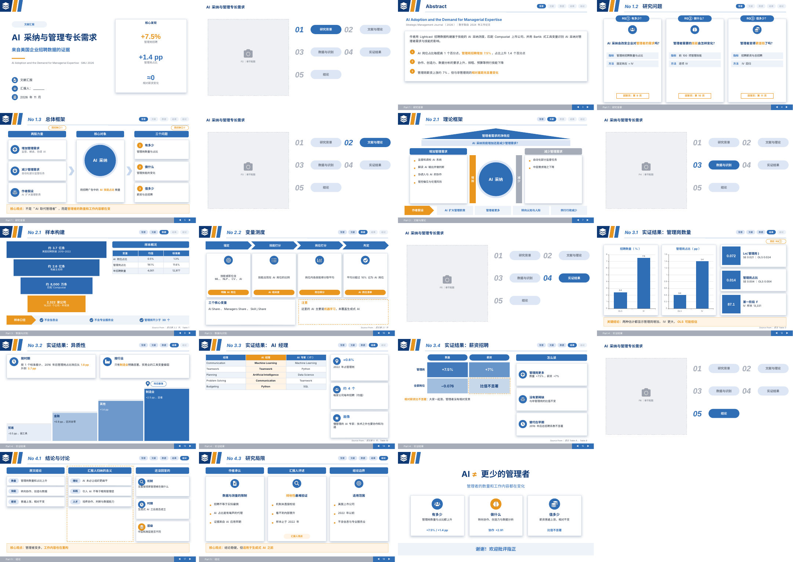

# doc-to-ppt

**把论文、研究方案做成中文汇报 PPT。** 风格在网页里点选，内容交给你常用的任意 AI 写，最后在网页里预览、改字、一键导出可编辑的 `.pptx`（含动画和讲稿）。

- 🖼️ **看得见的模板库**：所有已收录的风格都用同一份示例渲染出来，直接对比。
- 🎛️ **点选式配置**：页眉、页脚、卡片立体感、标题框、编号、图标、强调方式、动画、字体，全部是按钮，可以混搭。
- 🤖 **不绑定某一家 AI**：网页生成一段提示词，发给 Claude、ChatGPT、Kimi、DeepSeek 都行；AI 只负责写 `deck.json`。
- 🧩 **16 种学术汇报版式**：研究问题三列、总体框架、房屋框架、分级台阶、等级矩阵、漏斗、流程、图表 + 结论卡……
- 🔒 **纯前端**：没有服务器，文件只在你的浏览器里处理。

> 在线使用：**[jerry111-8.github.io/doc-to-ppt](https://jerry111-8.github.io/doc-to-ppt/)**（开通方法见 [docs/UPLOAD.md](docs/UPLOAD.md)）


## 三步用法

```
① 选风格（网页） ──► ② 任意 AI 写内容（deck.json） ──► ③ 预览、改字、导出（网页）
```

1. **选风格**：打开“模板库”挑一套，或者在“配置风格”里逐项点选。
2. **写内容**：在“配置风格”点 **复制给 AI 的提示词**，连同论文一起发给 AI。AI 会先给你看**主线**和**分镜表**，你确认后它输出 `deck.json`。
3. **导出**：在“预览与导出”点 **粘贴 AI 的回复**（会自动提取其中的 JSON）。逐页检查、改字、换版式，然后点 **导出 PPTX**。

交付前建议用 [prompts/review.md](prompts/review.md) 开一个新对话，让另一个 AI 对照原文核查数字、引用和前后一致性。

| 配置风格 | 预览与导出 |
|---|---|
|  |  |

示例成品（`examples/example.pptx`，蓝橙立体风格）：



## 内置模板

| 模板 | 特点 | 适合 |
|---|---|---|
| 蓝橙学术 | 一种主蓝 + 橙色强调，斜杠页眉，柔和投影 | 文献汇报、开题答辩（默认） |
| 蓝橙立体 | 投影更重、圆角标题框，按讲稿语速自动出现动画 | 大教室、投影大屏 |
| 墨绿简约 | 细线页眉、扁平浅底、线性图标 | 管理、社科 |
| 绛红稳重 | 红灰配色，偏正式 | 校级展示、人文 |
| 深海科技 | 只描边卡片、方块编号、青绿强调 | 工程、计算机、数据 |

想加自己的模板？在网页里调好后下载 `style.json`，按 [CONTRIBUTING.md](CONTRIBUTING.md) 提交 Pull Request，或者在 Issues 里选“提交新模板”。

## 给 Claude 用户

[skill/SKILL.md](skill/SKILL.md) 是交互版技能，用点选式对话走完整个流程：主线 → 用途 → 风格 → 组件 → 分镜 → 生成 → 独立审查。它也能只审查一份已经做好的 PPT（模式 R）。生成时调用的是同一个引擎，所以效果和网页一致。

## 命令行

```bash
npm install
node engine/cli.js examples/deck.example.json blue-orange-3d out.pptx
#                  deck.json                style.json 或主题名  输出文件
```

## 目录结构

```
index.html  app.js  app.css   网页：模板库、版式库、配置风格、预览与导出
engine/doc2ppt.js             引擎：版式 → 绘制指令 → HTML 预览 / .pptx（浏览器和 Node 通用）
engine/cli.js                 命令行生成
engine/icons.js               图标（Font Awesome Free + Feather）
themes/*.json                 模板；themes.js 和 index.json 由 tools/build-themes.js 生成
prompts/universal.md          给任意 AI 的提示词（由 tools/build-prompts.js 生成）
prompts/review.md             独立审查提示词
skill/SKILL.md                Claude 技能
examples/                     示例 deck.json 和成品 PPT
lib/pptxgen.bundle.js         PptxGenJS 4.0.1（已内置，离线可用）
```

## 已知限制

- 预览用你电脑上已有的字体；导出的 PPT 默认用微软雅黑，换到别的电脑上可能被替换。
- 动画只有在 PowerPoint / WPS 里放映时才看得到。
- 网页里导入的模板只存在本机浏览器里；要让所有人都能看到，需要提交到仓库。
- 读论文、写主线、写讲稿仍然需要 AI；这个工具负责的是风格、版式和导出。

## 许可

MIT。第三方：PptxGenJS（MIT），Font Awesome Free 图标（CC BY 4.0），Feather 图标（MIT）。
